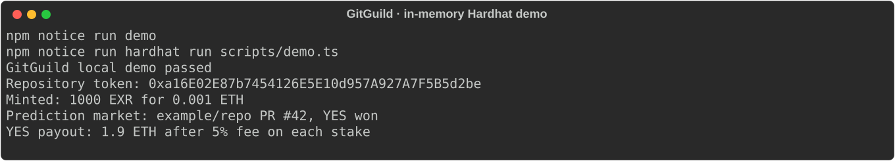
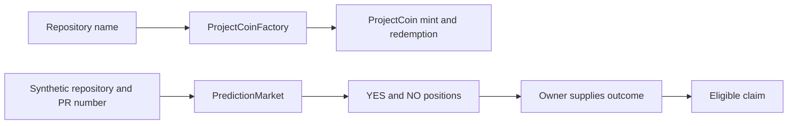

<div align="center">

# GitGuild

**Explore repository tokens and pull-request outcome markets on a local chain.**

A BlockTrain hackathon prototype with separate ERC-20 repository tokens and owner-resolved YES/NO markets.

[](https://github.com/Muneer320/GitGuild) [](blockchain/hardhat.config.ts) [](LICENSE)

[**Run the contract demo**](#try-it-with-local-test-eth) · [**Two systems**](#two-contract-ideas-one-hackathon) · [**Trust boundaries**](#who-controls-the-outcome)

</div>

## Two contract ideas, one hackathon

GitGuild explored how on-chain mechanics might sit beside repository activity. One system registers and mints a token associated with a repository name. The other accepts YES/NO positions on a PR outcome and pays eligible claims after its owner resolves the market. They are separate mechanisms, with explicit trust in the contract owners.



*Real script output from a disposable in-memory Hardhat network. Values are local test ETH; the example repository and PR are synthetic. No public deployment or real funds are involved.*

| Repository tokens | PR outcome markets |
| --- | --- |
| Register an ERC-20 for a repository name, mint and redeem against remaining contract ETH | Stake YES/NO, wait for the owner-supplied outcome, then claim an eligible share |
| `ProjectCoinFactory` / `ProjectCoin` | `PredictionMarket` |

> [!IMPORTANT]
> **Archived, unaudited prototype—use local test ETH.** The contracts do not verify GitHub ownership or PR outcomes. A repository token is not a token for each PR, and a PR merge does not automatically pay repository-token holders.

## Try it with local test ETH

Use Git and Node.js 22, matching the existing CI configuration:

```sh
git clone https://github.com/Muneer320/GitGuild.git
cd GitGuild
npm ci
npm test
npm run demo --workspace blockchain
```

The script deploys both systems in memory, creates a repository token, mints it, opens/resolves a synthetic YES/NO market and checks the payout. It needs no wallet, API key or real ETH. Ending the command discards that in-memory chain.

<details>
<summary><strong>Run the Next.js interface with a local chain and disposable wallet</strong></summary>

To use the web app, keep three terminals open in the repository root:

```bash
# Terminal 1: local blockchain
npm run node --workspace blockchain

# Terminal 2: deploy both contracts to that blockchain
npm run deploy:local --workspace blockchain

# Terminal 3: start the web app
npm run dev
```

The local deployment writes the contract addresses to the ignored file `frontend/.env.local`. Open http://localhost:3000. Connect an injected wallet such as MetaMask to the local network at `http://127.0.0.1:8545`, chain ID `31337`. Import **only a disposable Hardhat test account** from Terminal 1. Hardhat test account keys are public and must never hold real funds. Restart the web app after redeploying because the contract addresses change.

See [SETUP.md](SETUP.md) for the short setup checklist and [USAGE.md](USAGE.md) for the demo flow.

</details>

## From registration to an owner-resolved claim



<details>
<summary><strong>Fees, redemption, payout rules and incomplete token mechanisms</strong></summary>

| Action | Contract behavior |
| --- | --- |
| Register a repository token | Factory charges 0.01 ETH by default. It does not verify GitHub ownership. |
| Mint tokens | Initial batch price is 0.001 ETH per up to 1,000 tokens. Each batch increases the next price by 0.0001 ETH. |
| Split mint payment | 30% treasury, 40% reward pool address, 10% project creator, 20% stays in the token contract. The retained portion is not an automated buyback. |
| Redeem tokens | Burns tokens for a proportional share of ETH held by the token contract, less a 2% redemption fee. Redemption can fail if the contract has no ETH. |
| Stake on a PR market | 5% of each ETH stake goes to the market owner; 95% enters the YES or NO pool. |
| Resolve a PR market | Only the owner can report the outcome. The contract does not check GitHub. |
| Claim | Winning wallets receive a proportional share of both pools. If nobody backed the winning outcome, wallets on the other side can reclaim their net stakes. |

The `ProjectCoin.resolveMarket` function records an owner supplied PR outcome and multiplier, but does not distribute a payout. The `ProjectCoin.buybackBurn` function can only burn tokens already held by that contract; it does not buy tokens from users.

</details>

## Who controls the outcome?

This is a prototype. The contracts have **not been independently audited**. The factory owner can change its creation fee and default addresses. Each token owner can change treasury and reward pool addresses and can withdraw ETH held by the token contract, including ETH that could otherwise back redemptions. The market owner controls creation and resolution, and receives stake fees. A live Sepolia deployment has not been verified against this revision. Use local test ETH for the demo; do not use real funds.

These authority and liquidity limits are part of the implemented model. The prototype does not provide a trustless GitHub oracle, guaranteed token redemption or automated rewards for merged PRs.

## Source and history

| Area | Path |
| --- | --- |
| Contracts | [blockchain/contracts/](blockchain/contracts/) |
| Contract tests | [blockchain/test/](blockchain/test/) |
| Self-contained demo | [blockchain/scripts/demo.ts](blockchain/scripts/demo.ts) |
| Web app and wallet integration | [frontend/src/](frontend/src/) |
| Local setup / walkthrough | [SETUP.md](SETUP.md), [USAGE.md](USAGE.md) |

The archive preserves the BlockSmiths team project from BlockTrain. The [original team repository](https://github.com/WhyAsh5114/blocksmiths) credits WhyAsh5114 and pradyut-das; this repository also preserves Muneer Alam's work and its existing team history. For an exploratory fork, run the contract tests/demo and frontend build, and document any changes to fees, owner powers or settlement assumptions.

[MIT license](LICENSE) © 2025 Muneer Alam and contributors.
